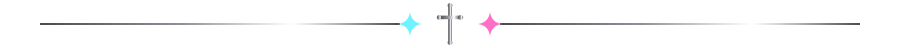
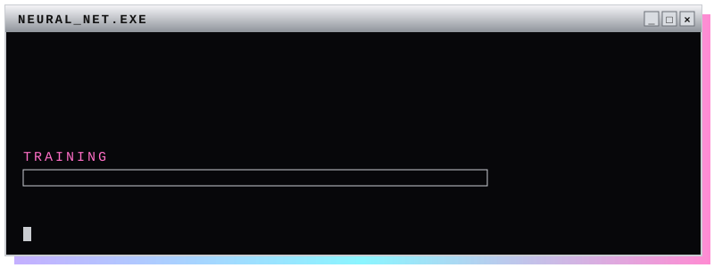

<p align="center">
  
</p>

<p align="center">
  <a href="https://github.com/your-username/neural-network-classification">
    
  </a>
</p>

<p align="center">
  
  
  
  
</p>



## ✦ ABOUT

A **neural network classification model** built from scratch to sort inputs into
classes. Data goes in, passes through stacked hidden layers, and comes out the
other side as a softmax probability for every class.

<p align="center">
  
</p>


## ✦ FEATURES

| ✧ | MODULE | DESCRIPTION |
|---|--------|-------------|
| ⛓ | **Preprocessing** | Cleaning, scaling, encoding, train/val/test split |
| ⛓ | **Model** | Fully connected network, ReLU hidden layers, softmax output |
| ⛓ | **Training** | Adam optimizer, early stopping, loss and accuracy tracking |
| ⛓ | **Evaluation** | Accuracy, precision, recall, F1, confusion matrix |
| ⛓ | **Inference** | Load the saved model and predict on new data |


## ✦ QUICK START

```bash
# clone
git clone https://github.com/your-username/neural-network-classification.git
cd neural-network-classification

# install
pip install -r requirements.txt

# train
python train.py --epochs 100

# predict
python predict.py --input data/sample.csv
```

<p align="center">
  
</p>


## ✦ ARCHITECTURE

```
INPUT  ──►  DENSE(128, relu)  ──►  DENSE(64, relu)  ──►  DENSE(n_classes, softmax)
```

| Hyperparameter | Value |
|----------------|-------|
| Optimizer | Adam |
| Learning rate | 0.001 |
| Loss | Categorical cross-entropy |
| Batch size | 32 |
| Epochs | 100 |

## ✦ RESULTS

| Metric | Score |
|--------|-------|
| Accuracy | `--` |
| Precision | `--` |
| Recall | `--` |
| F1 | `--` |

## ✦ PROJECT STRUCTURE

```
├── data/            # datasets
├── models/          # saved models
├── notebooks/       # experiments
├── train.py
├── predict.py
├── requirements.txt
└── README.md
```

## ✦ ROADMAP

- [x] Baseline network
- [ ] Hyperparameter tuning
- [ ] Dropout and regularization
- [ ] Confusion matrix visuals
- [ ] Deploy as an API


<p align="center">
  <sub>✧ built with loss, gradients and a little chrome ✧</sub>
</p>